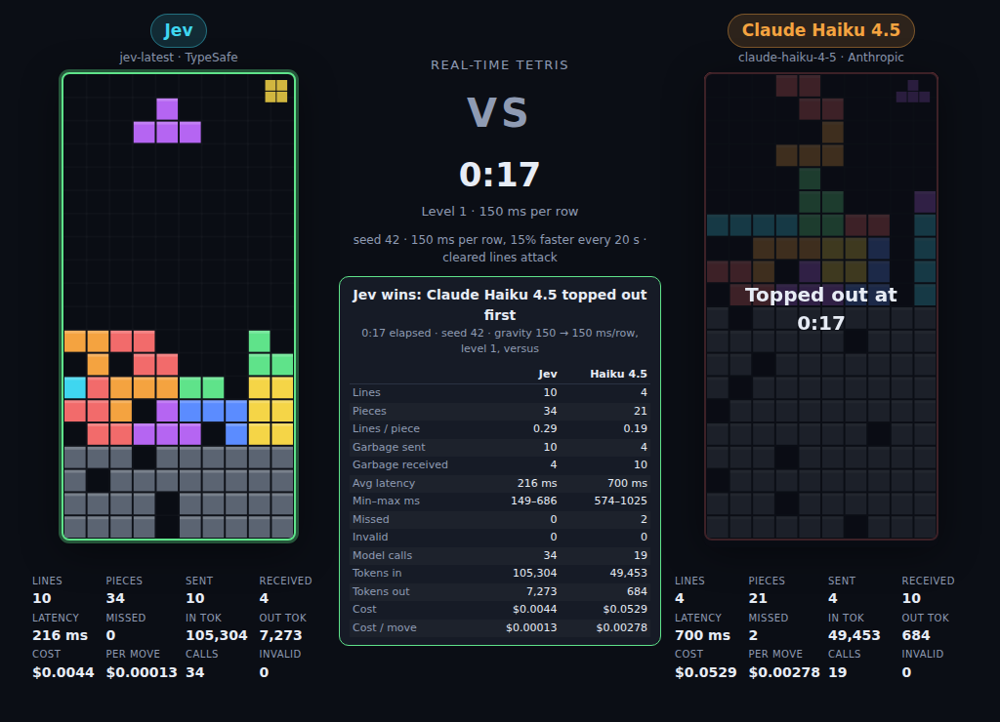
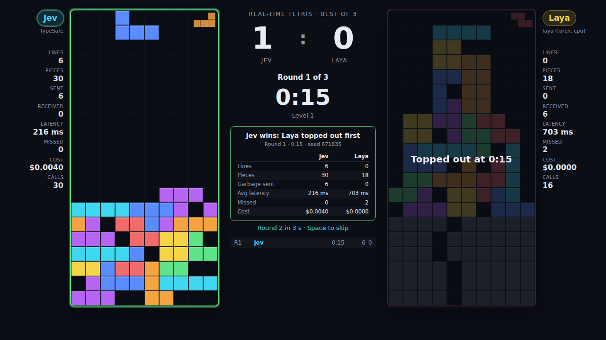
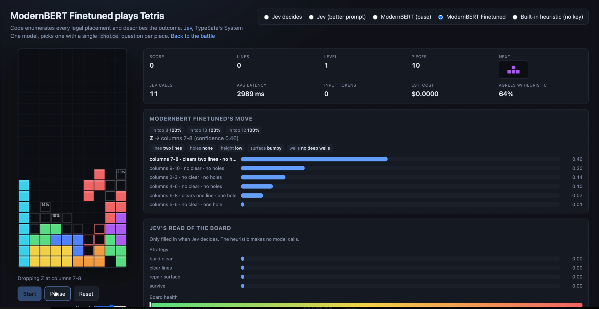

# Jev vs the LLMs: real-time Tetris

Two AI models play Tetris against each other in real time. [Jev](https://docs.typesafe.ai), TypeSafe's
System One model, faces chat models served through the GovTech Platform AI gateway — Claude Haiku 4.5,
Claude Sonnet 5.5, GPT-6 Luna, GPT-5.6 Sol — or another Jev prompt variant. Same piece sequence, same
options, same clock. Every line you clear lands on your opponent's board as a garbage row. Whoever tops
out first loses.

**Play it live:** [jev-tetris.vercel.app](https://jev-tetris.vercel.app)
(no keys in the browser — the server holds a TypeSafe key and a GovTech Platform key, and stores nothing).



## The battle

Each side runs its own real-time game loop on a seeded piece sequence shared by both players.

- **Decisions under a falling piece.** When a piece spawns, the model is asked at once. Meanwhile
  gravity pulls the piece down one row every N ms. When the answer arrives, the piece slides to the
  chosen column and rotation and hard-drops. If it lands before the answer arrives, it locks where it
  is: a missed deadline.
- **Gravity rises over time** on a schedule both sides share. Default: 150 ms per row, 15% faster
  every 20 seconds, floor 40 ms. The level shows under the clock. Gentle, brutal and constant
  schedules are selectable.
- **Versus.** Every cleared line becomes a garbage row (full except one gap) queued for the opponent
  and inserted under their stack when their current piece locks. A red counter shows incoming rows.
  If the push shoves the stack out of the top, that player is out, and the first to top out loses.
- **Same information for both.** Code enumerates every legal placement and describes each outcome in
  words (lines cleared, holes created, height, surface, wells). Jev answers with a Choice question
  over those options; a chat-model opponent (any model on the GovTech Platform gateway) gets the same
  board and option list and answers through a forced `place_piece` function call whose `option_id` is
  an enum of the same options. The opponent can also be a second Jev prompt variant — `jev-original`
  (the plain prompt) against `jev-better-prompt` (which adds the exact resulting board grid per
  candidate). All are constrained to legal moves; latency is part of the game. Pick the opponent in
  the setup card or with `?opponent=haiku-4-5`.
- **Stats per model.** Lines, pieces, garbage sent and received, average and min/max latency, missed
  deadlines, invalid answers, model calls, tokens in and out, cost and cost per move, live under each
  board and in a side-by-side table when the match ends.

Untick the versus box and the boards become independent; since a faster player cycles through more
pieces per minute, the survivor then has to outlast the loser's piece count to win. The "wait for
answers" toggle removes gravity so only decision quality is compared. Append `?present` to the URL
for a stripped-down layout meant for recordings.

### Recording a series: the presentation page

[`present.html`](public/present.html) is the layout for videos: boards as tall as the window, a
best-of-N score in the middle, the round clock, the round result and a round-by-round list, and
nothing else once the series starts. Every round draws a fresh random seed that both sides share.
Rounds follow each other after a pause you set (0 waits for you), and the series ends when one side
has a majority, with a totals table for the whole series.



Open [jev-tetris.vercel.app/present.html](https://jev-tetris.vercel.app/present.html) (or
`http://localhost:3000/present.html`), fill in the setup card, size the window to 1280 × 720 or
1920 × 1080, start your screen recorder and press **Start series**. Keys while it runs: Space starts
the next round now, Esc ends the round (twice to end the series), N opens the setup for a new series.
`?opponent=haiku-4-5&rounds=5&hold=8&gravity=150&speedup=normal&seed=42` pre-fills the form; `seed`
switches to reproducible seeds (seed, seed+1, …) instead of random ones.

## Play against Jev yourself

[jev-tetris.vercel.app/play.html](https://jev-tetris.vercel.app/play.html) puts you on the left
and Jev on the right with the same versus rules: shared piece sequence, rising gravity, cleared
lines become garbage for the other side, first to top out loses. Arrow keys move, up or X rotates,
Z rotates back, down soft-drops, space hard-drops; on touch screens a button row appears under the
board. You get a ghost piece and a short lock delay. Gravity starts gentler than in the model battle
(500 ms per row, 10% faster every 30 s) and is adjustable. No key in the browser — the server holds it.

## Single player: Jev on its own

[jev-tetris.vercel.app/solo.html](https://jev-tetris.vercel.app/solo.html) shows one Jev game with
every decision explained: the chosen placement with confidence, the alternatives with their probabilities drawn as
ghost outlines on the board, Jev's read of the board (strategy, health, whether the next piece has a
clean spot), token usage, cost, and the raw request and response.



Jev is not a text generator or a planner. It answers typed questions about a piece of state and
returns calibrated probabilities, so the split of work follows TypeSafe's
[building guide](https://docs.typesafe.ai/concepts/how-to-build-with-system-one): code owns the
game, Jev supplies the judgment.

1. **Code enumerates every legal placement**, simulates it, and computes the outcome. See
   [`public/tetris.js`](public/tetris.js).
2. **Code turns the numbers into words.** Jev reads text and is weak at arithmetic
   ([jaggedness notes](https://docs.typesafe.ai/model-jaggedness/jev-1.13)), so each placement becomes
   a small object with the same fields on every option: `lines_cleared: "two lines"`,
   `holes_created: "none"`, `stack_height_after: "low"`, `surface_after: "flat"`, and so on.
3. **One request to `POST /v1/systemone`** carries the board as state plus four questions
   ([speculative fan-out](https://docs.typesafe.ai/patterns/fan-out)). See [`public/jev.js`](public/jev.js).

   | Question | Type | What it does |
   | --- | --- | --- |
   | `placement` | Choice over every placement | Drives the game. The chosen option is dropped. |
   | `strategy` | Choice (`build_clean`, `clear_lines`, `repair_surface`, `survive`) | Shown as Jev's game plan. |
   | `board_health` | Score over four levels | Shown as a gauge. |
   | `next_piece_fits` | Noul | Shown as a probability bar. |

4. **Code acts on the answer.** The chosen placement is animated and locked. A classic hand-tuned
   heuristic runs alongside, and the panel shows how often Jev agrees with it.

Each move is one request of roughly 2,500 to 4,000 input tokens. A 150-piece game measured about
240 ms per move and roughly 530k input tokens, about two cents at the published price. Observed play:
50 lines over 150 pieces without topping out, 69% agreement with the heuristic. Jev takes single-line
clears readily and tolerates holes more than the heuristic does; the `priorities` list in
`public/jev.js` is where to push it toward cleaner play. No key? Switch to the built-in heuristic to
watch the code-only player.

## Run it yourself

Requires Node.js 20 or newer. There are no dependencies.

```sh
npm start
# open http://localhost:3000 (battle) or http://localhost:3000/solo.html (single player)
```

Or deploy your own copy to Vercel; the repo ships `api/` functions that act as the proxy:

[](https://vercel.com/new/clone?repository-url=https%3A%2F%2Fgithub.com%2Ftrungdq88%2Fjev-tetris&project-name=jev-tetris&repository-name=jev-tetris)

Any host that runs `npm start` on a Node 20+ box works too.

### Why there is a server

`api.typesafe.ai` rejects browser origins (CORS), so the page cannot call it directly.
[`server.mjs`](server.mjs) serves the static files and forwards `POST /api/systemone` and
`GET /api/models` to TypeSafe, and `POST /api/platform` to the GovTech Platform AI gateway, using the
keys the server holds in its environment (the browser sends none). It also appends battle/solo
decision rows posted to `POST /api/log` as JSON grouped by state under `data/battles/`. It keeps no key client-side
and never logs one. The same logic runs as Vercel functions in `api/`.

Environment variables:

| Variable | Meaning |
| --- | --- |
| `PORT` | Port to listen on. Default `3000`. |
| `TYPESAFE_API_KEY` | Jev key the server uses for every `/api/systemone` call. The browser sends no key. |
| `TYPESAFE_API_BASE` | Override the TypeSafe API base URL. |
| `PLATFORM_API_KEY` | GovTech Platform gateway key the server uses for every opponent (`/api/platform`). |
| `PLATFORM_API_BASE_URL` | Override the Platform gateway base URL. Default `https://api.ai.tech.gov.sg/platform/models`. |

Behind a corporate proxy, run with `NODE_USE_ENV_PROXY=1` so Node's `fetch` honours `HTTPS_PROXY`.

## Tests

```sh
npm test
```

Unit tests cover the engine (placement enumeration, line clears, hole counting, garbage rows, seeded
piece sequences) and the request builders (one criteria entry per placement, stable field names,
answer mapping, the Haiku tool schema and reply parser).

## Files

```
server.mjs             local static server + proxies + decision log
lib/typesafe.mjs       TypeSafe proxy logic shared by server.mjs and api/
lib/platform.mjs       GovTech Platform AI gateway proxy for the opponents
api/*.js               the same proxies as Vercel serverless functions
vercel.json            Vercel config (static public/, functions in api/)
public/index.html      battle page (+ battle.css, battle.js)
public/present.html    best-of-N presentation page for recordings (+ present.css, present.js)
public/play.html       human vs Jev (+ play.js)
public/arena.js        shared two-board machinery: sides, drawing, stats, garbage, gravity ramp, model loop
public/players.js      Jev and GovTech Platform chat-model players for the battle
public/solo.html       single-player page (+ style.css, app.js)
public/battle.html     redirect to the front page for old links
public/tetris.js       pure engine: pieces, placements, outcome descriptions, shortlist, garbage, seeded RNG
public/jev.js          Jev request builder, API call with retry, answer mapping
public/prompt.js       render state/candidate text and decision-log rows
tools/gen-dataset.mjs  headless Jev self-play → training dataset (prompt + probability per candidate)
tools/analyze-shortlist.mjs  recall@K sweep for shortlistPlacements (how small the candidate list can go)
tools/laya_server.py   standalone HTTP wrapper around Laya with the TypeSafe request shape
test/tetris.test.mjs   node --test suite
```

## Tuning

Everything Jev sees is in `buildState` and `buildQuestions` in [`public/jev.js`](public/jev.js);
the opponent chat prompt and `place_piece` tool are in [`public/players.js`](public/players.js). The `priorities`
list inside Jev's `placement` question is where to change how it weighs line clears against holes
and height. The word buckets for each feature live in the `describe*` helpers in
[`public/tetris.js`](public/tetris.js). Keep the numbers in code and hand the models the comparison.

## ModernBERT candidate model (Python)

The model implementation is in `models/modernbert.py`; the implementation plan is
in `plans/modernbert-model.md`. It scores each existing `STATE` + `CANDIDATE` prompt
with ModernBERT CLS → dropout(0.1) → bias-free linear(H, 1). The encoder and head
are both trainable. Batched inference is implemented in `models/inference.py`.
A training pipeline and arena integration are deferred.

Use Python 3.12 in a virtual environment and install `requirements-model.txt`:

```sh
python3.12 -m venv .venv
.venv/bin/python -m pip install -r requirements-model.txt
.venv/bin/python -m unittest discover -s test -p 'test_*.py'
```

The offline check uses a tiny real ModernBERT encoder, verifies gradients,
per-state normalization/masking, malformed input rejection, and checkpoint restoration.
Loading the full pretrained encoder separately downloads Hugging Face weights:

```python
from models.modernbert import ModernBertScorer, distillation_loss

model = ModernBertScorer.from_pretrained()
# input_ids, attention_mask: [total_candidates, tokens], right padded, CLS first.
# group_sizes: positive Python integers, one per state; sum = total_candidates.
# teacher_probabilities: float tensor [total_candidates], normalized per state.
logits = model(input_ids, attention_mask)
loss = distillation_loss(logits, teacher_probabilities, group_sizes)
loss.backward()
model.save_checkpoint("model.pt")
restored = ModernBertScorer.load_checkpoint("model.pt")
```

This is a tensor-level usage sketch; the caller supplies the tensors. Use
`AutoTokenizer.from_pretrained(model.tokenizer_id)` with special tokens, right
padding, and no silent truncation. Keep prompt construction identical to
`public/prompt.js`. IDs, `is_choice`, and target probabilities are not input text.
Checkpoints save encoder configuration, dropout, tokenizer identity, dependency
versions, and all encoder/head weights. Loading restores on CPU without network
access; callers choose device and train/eval mode. If using a custom tokenizer,
save its files alongside the checkpoint and keep its recorded path accessible.

`candidate_probabilities(logits, group_sizes, valid_mask=None)` returns flat
probabilities aligned with the input rows, separately normalized per state.
The optional Boolean mask excludes candidates from that state's choice set;
zero or negative logits are never excluded automatically. All-masked states are
rejected. The loss averages soft-target cross-entropy equally over states and
normalizes only rounding discrepancies within 1e-4 of unit target mass.

**Dataset caveat:** `createJevPlayer({betterPrompt: true})` offers a shortlist to
Jev but logs all placements; `stateRows` fills missing probabilities with zero.
Those unoffered moves do not have teacher judgments. Before training, persist or
reconstruct the exact offered set and exclude unoffered moves from its loss
normalization. A zero alone cannot identify an unoffered move. Sum-to-one checks
cannot detect this ambiguity. The headless generator currently also lacks run IDs;
add episode metadata before splitting data by run to avoid adjacent-state leakage.

An untuned model has a pretrained encoder and a **random scoring head**. Its
probabilities are not calibrated move preferences. A later arena baseline should
save its seed/checkpoint and compare both decision quality and latency.


### Run inference for one state

Load the scorer and tokenizer once, then pass a list of the existing rendered
prompts. All prompts must have the same `STATE` block; each includes its own
`CANDIDATE` block and `board_after`. The function tokenizes all candidates into
one padded batch, runs the encoder/head once in evaluation mode with gradients
disabled, and applies softmax across that batch. It leaves the model in eval mode.

```python
from transformers import AutoTokenizer
from models.modernbert import ModernBertScorer
from models.inference import run_inference

model = ModernBertScorer.load_checkpoint("model.pt")  # restores encoder AND head
# For an untuned baseline instead: model = ModernBertScorer.from_pretrained()
tokenizer = AutoTokenizer.from_pretrained(model.tokenizer_id, padding_side="right")

result = run_inference(
    model, tokenizer,
    prompts=[state_candidate_1_prompt, state_candidate_2_prompt],
    candidate_ids=["p1", "p6"],
)
print(result["probabilities"])       # same order as the input candidates
print(result["chosen_candidate_id"])
print(result["chosen_prompt"])       # includes the selected candidate's board_after
```

`chosen_index` is zero-based; if IDs are omitted, IDs default to input indices.
The output also includes raw `logits`. The model selects a supplied next state;
it does not generate a board or apply a move to the game engine. Ties select the
first eligible candidate. Optional `valid_mask=[True, False, ...]` excludes
candidates explicitly; zero logits and zero teacher labels do not exclude them.
Inputs from different current states, empty batches, duplicate candidate IDs,
all-false masks, and overlong prompts are rejected. No text is silently truncated.
Call `model.to("cuda")` or `model.to("mps")` before inference to choose a device;
CPU is supported and is the CLI default.

The CLI accepts the nested dataset format below, a JSON array of prompt strings,
or legacy rows containing `state_id`, `candidate_id`, and `prompt`. For multiple
states, select one explicitly with `--state-id`.
It ignores teacher `probability` and `is_choice` fields and writes JSON to stdout:

```sh
# Untuned baseline: downloads pretrained encoder/tokenizer on first use.
.venv/bin/python -m models.inference \
  data/battles/solo-jev-better-prompt-2026-10-01T18-05-48-327Z.json \
  --state-id 'solo-jev-better-prompt-2026-10-01T18-05-48-327Z:2' \
  --baseline --seed 7

# Saved scorer, including its learned head:
.venv/bin/python -m models.inference candidates.json --checkpoint model.pt
```

Supply `--tokenizer PATH_OR_ID` to override tokenizer metadata, and `--device`
to select CPU, CUDA, or MPS. No arena server is started by this command.

Verified on Python 3.12.13, PyTorch 2.14.1, Transformers 4.57.6: the offline
suite covers real tokenization/encoding, one-call batching, softmax/choice,
padding, ordering, repeated calls, exclusions, errors, and the checkpoint CLI.
A full ModernBERT-base CPU smoke run on the recorded two-candidate state with
seed 7 produced probabilities approximately `[0.505819, 0.494181]`, selecting
`p1`. This validates the inference path, not playing strength: the head is random.


### Dataset JSON format

Both `POST /api/log` and `tools/gen-dataset.mjs` now save:

```json
{
  "run:2": {
    "p1": {"prompt": "STATE\n...\n\nCANDIDATE\n...", "probability": 0.94, "is_choice": true, "run": "run"},
    "p6": {"prompt": "STATE\n...\n\nCANDIDATE\n...", "probability": 0.06, "is_choice": false, "run": "run"}
  }
}
```

State IDs and candidate IDs are keys rather than repeated fields. Every other
candidate field is preserved, including `run` when provided. The browser still
posts `{run, rows}`; the shared disk writer groups those rows and merges them into
`data/battles/<run>.json`. It serializes concurrent writes in this Node process
and atomically replaces the JSON file; conflicting existing candidates are
rejected instead of overwritten. Identical retries are accepted. The headless
generator merges each completed seed into its output using the same writer.
Existing flat JSON arrays are upgraded on the next write; old `.jsonl` logs are
not automatically imported.

The provided solo dataset was converted in place: 351 candidates across 110
states. Its original flat array is preserved as the adjacent `.flat.json.bak`
file. Grouping does not change teacher labels or infer whether a candidate was
offered to the teacher. Inference reads the nested file directly, preserving
candidate order within each state.
