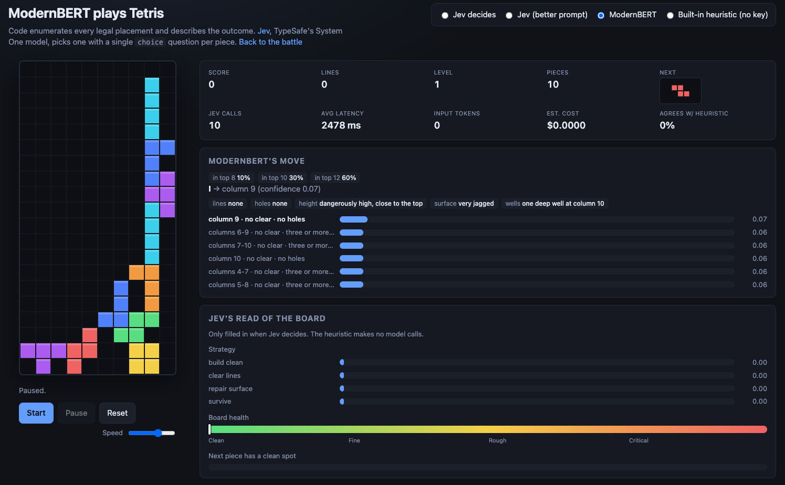

# ModernBERT, fine-tuned to play Tetris

A small encoder (`answerdotai/ModernBERT-base`, 150M params) fine-tuned to pick Tetris placements.
Code enumerates every legal placement and describes each outcome in words; the model reads the board
plus one candidate and emits a single score. A softmax over a state's candidates turns those scores
into a move distribution. No arithmetic, no planning, no board generation — just *which of these
placements is best*, learned by distillation from two teachers.


The selector also carries **ModernBERT (base)** — the same architecture with a *random* scoring head,
no fine-tuning. That is the honest baseline: the wiring is identical, the policy is not. It spreads
its probability almost flat (every candidate ~0.06–0.07), agrees with the heuristic 0% of the time,
and buries itself:



Fine-tuning is the whole difference between those two pictures.

## The scoring task

The model never sees raw numbers. Jev (and ModernBERT after it) is weak at arithmetic, so code turns
every placement into words with the same fields on every option: `lines_cleared: "two lines"`,
`holes_created: "none"`, `stack_height_after: "low"`, `surface_after: "flat"`, and so on. Pieces are
simulated, outcomes described, and the model ranks them.

- **Head.** A single bias-free `Linear(hidden → 1)` on the CLS token with dropout `0.1`. One scalar
  score per candidate. No classification layer — scoring is relative *within* a state.
- **Framing.** Each example is one board state with ~10 candidate placements. The `STATE\n…` prefix
  plus each candidate's `CANDIDATE\n…` section are tokenized as a full sequence sharing the state
  prefix. `log_softmax` over a state's candidates turns scores into a distribution. This is a
  **listwise learning-to-rank / distillation** setup, not per-example classification.
- **Loss.** Soft cross-entropy against the teacher distribution:
  `loss = -(target * logits.log_softmax(0)).sum()`, averaged equally over states.
- **Accuracy** = top-scored candidate matches the teacher's top choice (argmax agreement), *not*
  gameplay win rate.

Implementation: `models/modernbert.py` (model + grouped loss), `models/inference.py` (batched
inference). Prompt construction mirrors `public/prompt.js` exactly — identical text to what the game
renders. See [`docs/training-methodology.md`](docs/training-methodology.md) for the full rationale;
the authoritative pipeline is `model_training/model_training.ipynb` (full fine-tune via Unsloth).

## How it's trained

**Base model.** `answerdotai/ModernBERT-base`, **full** fine-tune (encoder + head, no LoRA/adapters),
loaded through Unsloth's `FastModel` with `full_finetuning=True`.

**Two teachers, two rounds (curriculum SFT).** Round 2 resumes Round 1's weights, each a full
fine-tune with a fresh optimizer and LR schedule:

| Round | Teacher | Data | Starts from |
|---|---|---|---|
| 1 | Dellacherie-Thiery heuristic | `data/heuristic-training/*.json` | fresh pretrained + random head |
| 2 | Jev (TypeSafe System One) | `data/battles-training.jsonl` | Round 1's `model.pt` |

The heuristic gives cheap, abundant, difficulty-balanced labels to teach board sense first; Jev's
logs are scarce and are the real distillation target, applied second so the model specializes last.
The heuristic is a nine-feature DT afterstate evaluation with 2-ply next-piece lookahead
(`FEATURE_WEIGHTS` / `lookaheadScore` in `public/tetris.js`), softmaxed with a temperature knob to
spread near-one-hot scores into usable soft targets.

**Difficulty staging (5 stages).** Heuristic data is bucketed by pre-move stack height, pre-seeding
boards with random garbage so the hard/near-topout bands (which never occur in natural low play)
actually appear. Jev data is cut into 5 quantiles of a scalar `structural_difficulty(state)`.

**Blended curriculum (the key technique).** Not easiest-first blocks. Epoch 1 visits every training
state exactly once, reordered so difficulty shifts gradually easy→hard across four time phases
(`[0.10, 0.30, 0.30, 0.30]`), each with a target mix over the 5 stages, apportioned with Hamilton's
largest-remainder. Easy states thin out but persist late; hard states appear rarely at first and
dominate the end.

**Training profile (Colab T4).** Effective batch size ramps 16→32 states over the first 10% (one GPU
microbatch = all candidates of one state, dynamic right-padding within the state). WSD learning-rate
schedule (10% warmup → stable at peak `2e-5` → 20% cosine decay), `StableAdamW` (`torch-optimi`,
internal update clipping, no global grad clip), FP32 master weights with FP16 autocast + grad
scaling, SDPA attention, gradient checkpointing. Only successful optimizer updates advance the
schedule, so FP16 overflows never corrupt it.

**Split & hygiene.** 81/9/10 train/val/test **by whole episode** (one game = one episode), jointly
across both datasets, never looking at teacher probabilities. Exact-text dedup across splits
(test > validation > train) so holdouts never leak. Single-candidate states are excluded from
training but kept in eval; primary metrics cover only real **decisions** (≥2 candidates). Seed
`3407` everywhere; each round saves `baseline.pt` and `model.pt` and compares them on the identical
held-out test decisions (`test_comparison.json`).

### Data pipeline

| Tool | What it produces |
|---|---|
| `tools/gen-heuristic-difficulty.mjs` | Round-1 corpus: difficulty-bucketed heuristic self-play, garbage-seeded per height band, one `episode_id` per game, `--max-per-game` cap for episode diversity |
| `tools/gen-dataset.mjs` | Headless Jev self-play → merged dataset (prompt + probability per candidate) |
| `data/collapse_battles.py` | Flattens `data/battles/` into `battles.jsonl`, scoring each state's structural difficulty + ambiguity into the 5-stage curriculum |
| `tools/solo-modernbert-eval.mjs` | Headless A/B: full solo games, base vs checkpoint on matched seeds, lines/pieces comparison, no browser or keys |

**Jev eligibility is strict, never inferred.** Every candidate carries an explicit `offered_to_jev`;
an unoffered candidate with nonzero teacher mass is a hard error; only offered candidates with
`probability_observed == True` (or a documented legacy exception) are kept. A zero probability alone
cannot identify an unoffered move, so `stateRows` records `offered_to_jev` and `probability_observed`
per candidate and training excludes unoffered moves from its loss normalization.

### Dataset JSON format

```json
{
  "run:2": {
    "p1": {"prompt": "STATE\n...\n\nCANDIDATE\n...", "probability": 0.94, "is_choice": true, "run": "run"},
    "p6": {"prompt": "STATE\n...\n\nCANDIDATE\n...", "probability": 0.06, "is_choice": false, "run": "run"}
  }
}
```

State and candidate IDs are keys, not repeated fields. `lib/dataset.mjs` groups rows by state and
atomically merges them into one `data/battles/<run>.json`; conflicting candidates are rejected rather
than overwritten, identical retries accepted. Prompts must start with `STATE\n`, contain exactly one
`\n\nCANDIDATE\n` separator, and share an identical STATE prefix across a state's candidates.

## Run it

### Train / verify the model (Python)

Python 3.12 in a virtualenv:

```sh
python3.12 -m venv .venv
.venv/bin/python -m pip install -r requirements-model.txt
.venv/bin/python -m unittest discover -s test -p 'test_*.py'
```

The offline suite uses a tiny real ModernBERT encoder and covers real tokenization/encoding,
one-call batching, softmax/choice, per-state normalization & masking, padding, ordering, gradient
flow to both head and encoder, malformed-input rejection, and checkpoint round-trip. Loading the full
pretrained encoder downloads Hugging Face weights.

```python
from models.modernbert import ModernBertScorer, distillation_loss

model = ModernBertScorer.from_pretrained()
# input_ids, attention_mask: [total_candidates, tokens], right padded, CLS first.
# group_sizes: positive ints, one per state; sum = total_candidates.
# teacher_probabilities: float tensor [total_candidates], normalized per state.
logits = model(input_ids, attention_mask)
loss = distillation_loss(logits, teacher_probabilities, group_sizes)
loss.backward()
model.save_checkpoint("model.pt")
restored = ModernBertScorer.load_checkpoint("model.pt")
```

Checkpoints save encoder config, dropout, tokenizer identity, dependency versions, and all
encoder/head weights; loading restores on CPU without network access. Keep prompt construction
identical to `public/prompt.js`; IDs, `is_choice`, and target probabilities are not input text.

### Inference for one state

```python
from transformers import AutoTokenizer
from models.modernbert import ModernBertScorer
from models.inference import run_inference

model = ModernBertScorer.load_checkpoint("model.pt")   # restores encoder AND head
tokenizer = AutoTokenizer.from_pretrained(model.tokenizer_id, padding_side="right")

result = run_inference(
    model, tokenizer,
    prompts=[state_candidate_1_prompt, state_candidate_2_prompt],
    candidate_ids=["p1", "p6"],
)
print(result["probabilities"])        # same order as input candidates
print(result["chosen_candidate_id"])
```

All prompts must share the same `STATE` block. The function tokenizes them into one padded batch,
runs the encoder/head once in eval mode with gradients disabled, and softmaxes across the batch.
Ties pick the first eligible candidate; `valid_mask=[True, False, ...]` excludes candidates
explicitly (zero logits/labels do not). Empty batches, duplicate IDs, mixed states, all-false masks,
and overlong prompts are rejected — no silent truncation.

CLI (accepts the nested dataset format, a JSON array of prompts, or legacy `state_id`/`candidate_id`/
`prompt` rows):

```sh
# Untuned baseline (downloads pretrained encoder on first use):
.venv/bin/python -m models.inference candidates.json --baseline --seed 7

# Saved scorer, including its learned head:
.venv/bin/python -m models.inference candidates.json --checkpoint model.pt --state-id 'run:2'
```

`--tokenizer PATH_OR_ID` overrides tokenizer metadata; `--device` selects CPU (default), CUDA, or MPS.

### As a live opponent (battle + solo)

ModernBERT is selectable in the solo page and the battle opponent dropdown. Because it is a local
PyTorch model rather than an HTTP LLM, `server.mjs` spawns one long-lived worker (`models/serve.py`)
on first use: it loads the model once, `compile_scorer()`s it, and answers one `POST /api/modernbert`
request per move over stdio. **Local-dev only** — Vercel functions cannot hold a torch process.

```sh
pip install -r requirements-model.txt        # first run downloads answerdotai/ModernBERT-base
MODERNBERT_CHECKPOINT=/path/to/scorer.pt npm run dev
```

Without a checkpoint it runs the untrained baseline (random head) and plays near-randomly. If torch
is not installed the route returns a clear 503 and the UI shows it.

#### Faster CPU serving via ONNX Runtime (optional)

Export the scorer to ONNX and serve it through ONNX Runtime (graph fused once at session load).
FlashAttention-2 is GPU-only and would not help here; ONNX + ORT is the CPU lever.

```sh
pip install -r requirements-model-onnx.txt
python -m models.export_onnx --baseline --tokenizer answerdotai/ModernBERT-base   # or --checkpoint scorer.pt
npm run dev   # worker logs source=onnx
```

Export defaults to `models/base-onnx/` (gitignored): `model.onnx`, a sidecar `model.onnx.json`
(tokenizer id + config), and external weights `model.onnx.data` (~596 MB for base) — keep the three
together. The base ONNX path is `config.json`'s `modernbertOnnx`; the solo/battle pages also expose
**ModernBERT (checkpoint)** from `modernbertCheckpointOnnx`:

```sh
python -m models.export_onnx --checkpoint models/modernBERT-base-shuffled/model.pt \
  -o models/checkpoint-onnx/model.onnx
```

One worker serves both but only one is resident at a time: a switch pays a reload, memory holds a
single model. ONNX improves latency/memory, **not** playing strength. FP16/INT8 quantisation are not
implemented.

Verified on Python 3.12.13, PyTorch 2.14.1, Transformers 4.57.6. A full ModernBERT-base CPU smoke run
on the recorded two-candidate state with seed 7 produced probabilities ≈ `[0.505819, 0.494181]`,
selecting `p1` — validating the inference path, not playing strength when the head is random.

## The game engine

The scorer only decides; the engine does everything else and feeds it the words.

- **Enumeration.** `public/tetris.js` enumerates every legal placement, simulates it, and computes
  the outcome. `describe*` helpers bucket each feature into the words the model reads.
- **Built-in heuristic.** The same nine-feature Dellacherie-Thiery evaluation with 2-ply lookahead
  (`FEATURE_WEIGHTS`, `lookaheadScore`) that labels Round 1 also runs as a code-only player and as
  the "agrees w/ heuristic" yardstick in the UI.
- **Solo page** (`public/solo.html`) explains every decision: the chosen placement with confidence,
  alternatives drawn as ghost outlines, the board read (strategy, health, next-piece fit), token
  usage, and the raw request/response. The decider selector switches between Jev, Jev (better
  prompt), ModernBERT (base), ModernBERT Finetuned, and the built-in heuristic. The board-read panel
  is only filled in when Jev decides; the heuristic makes no model calls.

### Node server & config

Node 20+, no dependencies. `server.mjs` serves the static files, forwards `POST /api/systemone` and
`GET /api/models` to TypeSafe and `POST /api/platform` to the GovTech Platform gateway (keys held
server-side, browser sends none), spawns the ModernBERT worker, and appends decision rows posted to
`POST /api/log` under `data/battles/`.

```sh
npm start   # http://localhost:3000/solo.html
```
